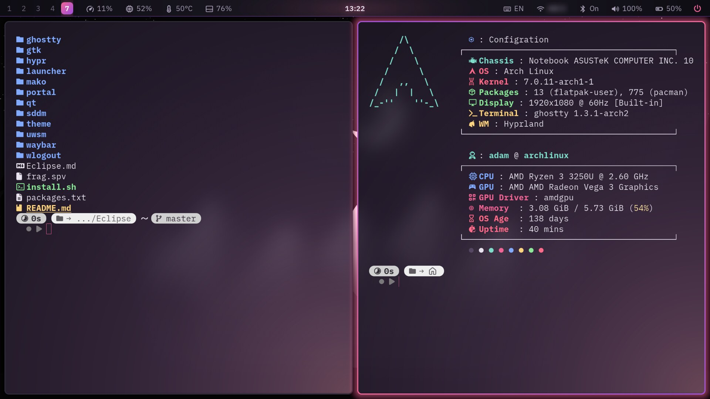
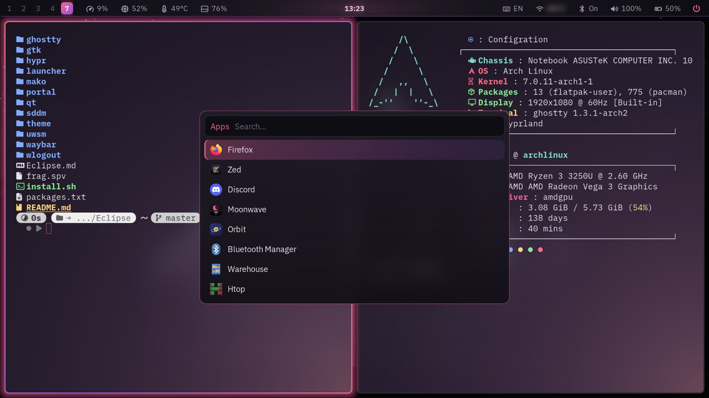
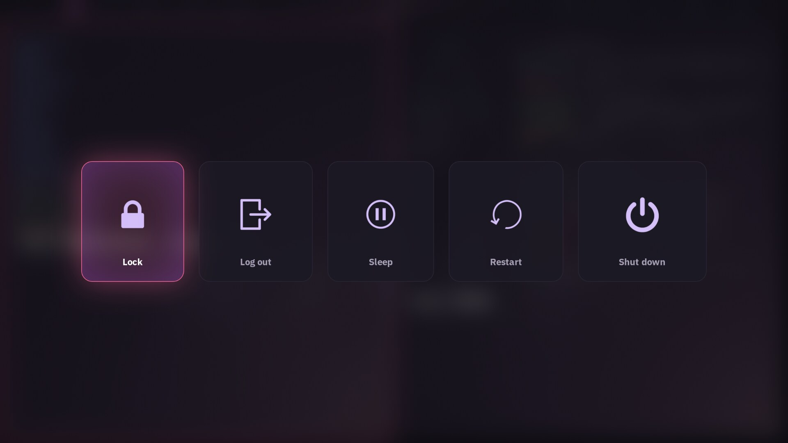
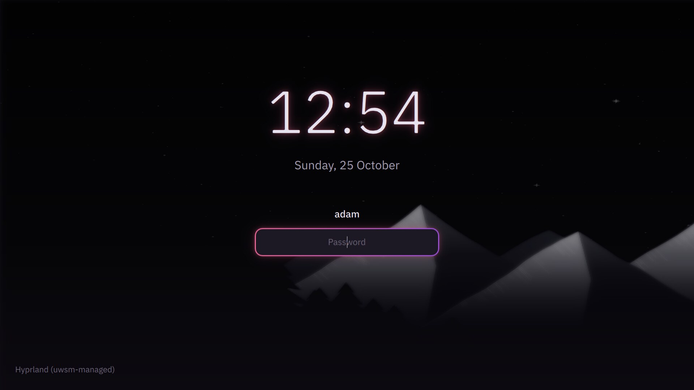

<p align="center"></p>

<h1 align="center">Eclipse</h1>

<p align="center">My own Hyprland setup, written from scratch.</p>

<table>
  <tr>
    <td></td>
    <td></td>
  </tr>
  <tr>
    <td align="center">Launcher</td>
    <td align="center">Power menu</td>
  </tr>
  <tr>
    <td colspan="2"></td>
  </tr>
  <tr>
    <td colspan="2" align="center">Login screen</td>
  </tr>
</table>

## Packages and Config Files

Hyprland (Lua config), Waybar, rofi, mako, wlogout, hyprlock, hypridle, hyprpaper, cliphist and an SDDM login theme, all in one dark theme (near-black, rose → plum) with IBM Plex. GTK and Qt apps follow it too. Apps: Firefox, Nautilus, Loupe, Papers, Ghostty, Text Editor, Calendar.

## Install

```sh
./install.sh --dry-run   # see what it would do
./install.sh             # install the packages, back up ~/.config, link Eclipse in
./install.sh --undo      # put the previous setup back
```

Then log out and log in to Hyprland. Your screens are in `hypr/screen.lua`; the colors are all in `theme/palette.sh` (run `theme/generate.sh` after changing them).

## Keys

| | |
|---|---|
| Super+T / B / E / N / C | Terminal, browser, files, notes, calendar |
| Super+A | Apps |
| Super+V | Clipboard history |
| Ctrl+Super+Left / Right | Previous / next workspace |
| Super+Q / F | Close, fullscreen |
| Super+1…0 | Workspaces |
| Super+K | English ⇄ Arabic |
| Super+L | Lock |
| Print / Shift+Print | Screenshot: area / screen |

All of them are in `hypr/keybinds.lua`.
